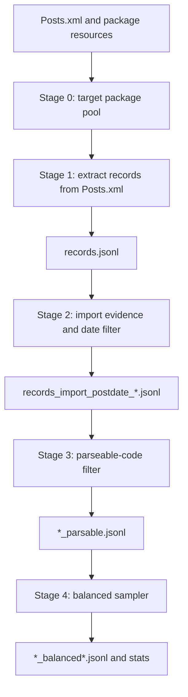

# PinTrace dataset construction

Build the PinTrace task set from a Stack Exchange `Posts.xml` dump. The paper sample is 1,000 library-balanced Python tasks posted from 2020 onward whose accepted answers import a third-party package present in the frozen OSV index.

## Entry point

`build_stackoverflow_dataset.py` runs the full pipeline: package-pool construction, record extraction, post-filtering, parseability filtering, and balanced sampling.



## Stages

### Stage 0: target package pool

Code: `package_pool.py` (`load_target_packages`, `build_package_pool`).

Sources:

1. `--target-packages-path`: a JSON list, a dict with `vulnerable_top_intersection`, or an alias-mapping dict keyed by canonical package name.
2. Automatic construction: top PyPI packages (`--top-limit`) intersected with OSV-covered packages, then expanded through `mapping.json` (import name to PyPI name).

`--top-limit` trades recall for precision. The mapping expansion recovers packages whose OSV name is an import alias (for example `PIL` to `pillow`).

### Stage 0.5: alias mapping (optional)

Code: `alias_mapping_converter.py::build_alias_mapping_for_targets`, `stackexchange_builder.py::load_alias_mapping`.

Inverts `mapping.json` to `package -> [aliases]`, keeps only packages in the target set, and skips self-aliases. Use `--alias-mapping-path` to supply a file, or `--disable-auto-alias-from-mapping` to turn the converter off.

### Stage 1: extract records from Posts.xml

Code: `stackexchange_builder.py::build_records_from_stackexchange_xml_v2`.

Pass 1 indexes questions with `PostTypeId == 1`, an accepted answer, `Score >= --min-score`, and `question_id < 1_000_000_000`.

Pass 2 keeps the accepted answer if it contains a fenced code block, is in a Python context (tags or parseable imports), and hits a target package. `match_mode`:

- `conservative`: code imports only
- `balanced`: question tags or code imports
- `recall`: balanced, plus text cues such as `pip install`

`--pass2-workers` sets concurrency. `--max-questions` stops after that many written records.

### Stage 2: import evidence and date filter

Code: `filter_so_records.py::filter_records`.

Keeps records with import evidence unless `--no-require-import-evidence`. Then filters `CreationDate >= --cutoff-date`. `date-filter-mode=exact` uses `answer_time_index.sqlite3`; `id_threshold` approximates the cutoff from answer IDs.

### Stage 3: parseable-code filter

Code: `filter_parsable_code.py::filter_parsable_records`.

Normalizes code blocks, drops those shorter than `--min-code-chars`, and classifies them with `ast.parse`. `--pair-pass-mode` is `any_block`, `merged`, or `any_or_merged` (default).

### Stage 4: balanced sampling

Code: `balanced_sampler.py::sample_balanced_records`.

Allocates about `N / K` tasks per represented package, then fills remaining slots toward under-covered packages. `--balanced-total` and `--balanced-seed` control size and reproducibility. The paper uses `N=1000` and seed `42`.

## Paper command

```bash
python -m dataset_builder.build_stackoverflow_dataset \
  --run-name so_e2e_balanced \
  --posts-xml-path /path/to/Posts.xml \
  --top-limit 15000 \
  --match-mode balanced \
  --cutoff-date 2020-01-01T00:00:00 \
  --date-filter-mode exact \
  --pair-pass-mode any_or_merged \
  --balanced-total 1000 \
  --balanced-seed 42 \
  --pass2-workers 8
```

Outputs land in `outputs/dataset_builder/<run-name>/`:

- `records.jsonl`: stage-1 candidates
- `records_import_postdate_*.jsonl`: stage-2 filter
- `*_parsable.jsonl`: stage-3 filter
- `*_balanced*.jsonl`: stage-4 sample used as PinTrace
- `summary.json` / `e2e_summary.json`

Precision-oriented settings: `match_mode=conservative`, `date-filter-mode=exact`, `pair-pass-mode=merged`. Higher recall: `match_mode=recall`.
